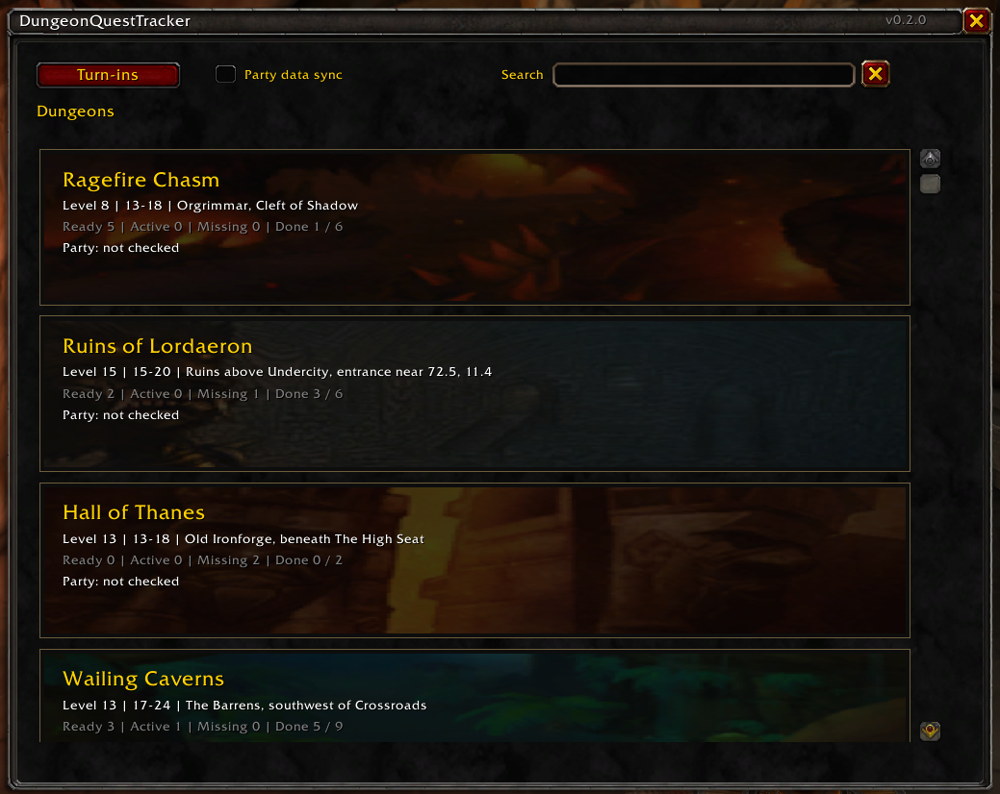
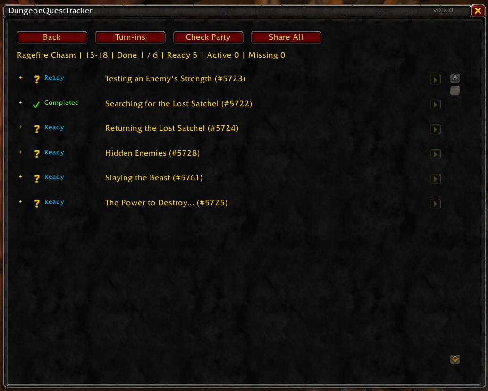
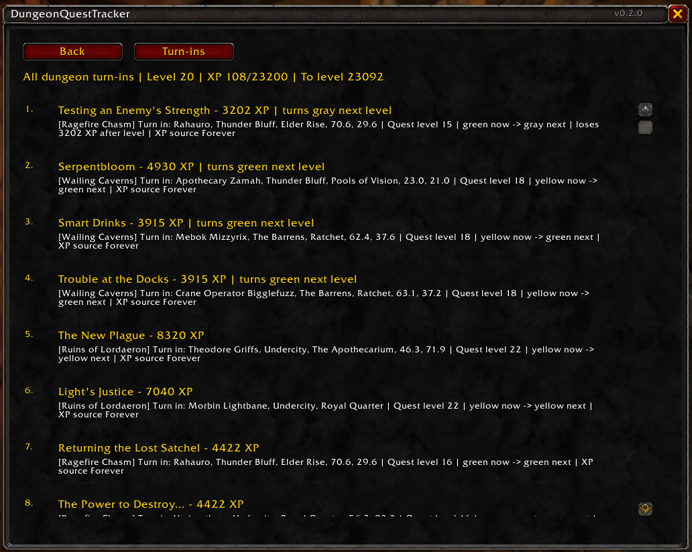
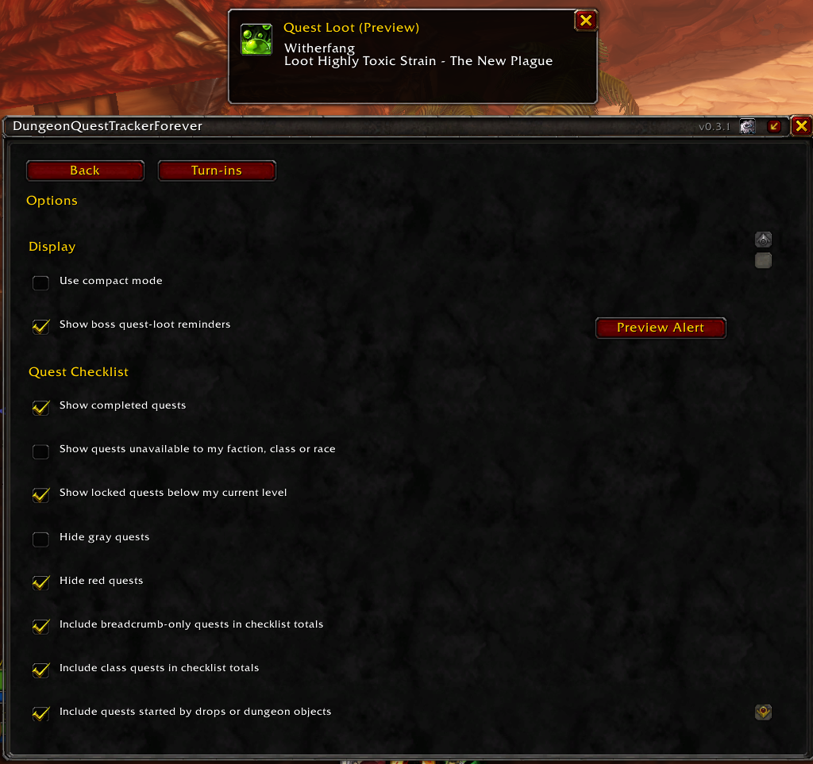

# DungeonQuestTrackerForever

A World of Warcraft: Forever addon for finding dungeon quests, following their prerequisite chains, planning pickups and prioritizing turn-ins.

Available on [CurseForge](https://www.curseforge.com/wow/addons/dungeonquesttrackerforever).

## Features

- Searchable, scrollable dungeon list with artwork, level ranges and party summaries.
- Search overrides dungeon visibility filters so you can find dungeons outside your current level range.
- Collapsible checklists showing completed, ready, active, missing and locked quests.
- Pickup and turn-in locations, prerequisite chains and grouped dungeon quest follow-ups.
- Faction, class, race and level-aware quest tracking.
- Global turn-in priority based on your level, XP and potential reward loss after leveling.
- Nearby turn-ins grouped together when doing so preserves XP priority.
- Pickup routes across all 35 dungeon/wing entries, using available quest locations, with independent inclusion settings, prerequisite tasks, refresh/reset and next-stop map focus.
- Already-ready prerequisite returns included before pickups, with required preparation kept visible.
- Current-position pickup starts where the client supports them, plus optional recorded entrance approaches.
- Flight-aware pickup itineraries with character-specific learned routes, manual flight knowledge, base fares and named boat/zeppelin/tram legs.
- Optional ready Hearthstone shortcuts, with character-specific bind destinations and a single-use reservation across each pickup itinerary.
- Optional same-map guide lines and TomTom next-stop focus, without requiring TomTom.
- Numbered world-map pickup pins with combined tooltips for shared locations.
- Compact and full display modes with saved preferences.
- Per-character dungeon favorites, optional favorites-first sorting and reusable settings profiles.
- Adjustable addon window scale, larger quest text and separate window/minimap/loot-alert position resets.
- Filters for quest completion, availability, level range and pickup type.
- Movable minimap button.
- Party quest status checks and individual or Share All quest sharing.
- Scrollable party readiness details distinguishing current, partial, stale and missing responses.
- Optional party quest-data sync for records missing from your addon catalog.
- Opt-in local quest XP recording with a manual export for maintainer review; observations never automatically change quest rewards or turn-in priority.
- Movable quest-item loot reminders with sound, click-to-dismiss, fade-out, saved placement and an Options preview.
- Loot-alert duration, sound selection, mute and Master/SFX channel preferences.
- Optional dungeon-entry preparation summaries and batched newly available chain notifications, deferred during combat and suppressible for the session.
- Filter explanations and manual diagnostic reports with a local preview before copying.

## Screenshots

### Dungeon List



### Quest Checklist



### Turn-In Priority



### Quest Loot Alert



Loot alerts cover known single-copy quest items from named mobs. Multi-item collection quests are excluded to avoid spam. Where a kill notification is unavailable, the reminder may only appear after opening the corpse's loot window. Alerts do not guarantee a drop or loot eligibility.

## Tracked Dungeons

- Ragefire Chasm
- Hall of Thanes
- Ruins of Lordaeron
- Wailing Caverns
- The Deadmines
- Shadowfang Keep
- The Stockade
- Blackfathom Deeps
- Excavation Site: Wetlands
- City of Dalaran
- Gnomeregan
- Razorfen Kraul
- Razorfen Downs
- Uldaman
- Scarlet Monastery: Graveyard, Library, Armory and Cathedral
- Zul'Farrak, Maraudon and The Sunken Temple
- Blackrock Depths, Lower Blackrock Spire and Upper Blackrock Spire
- Dire Maul: East, North and West
- Scholomance and Stratholme: Main Gate and Service Gate

Higher-level Classic quests are included through level 60 using Classic-source data. Dungeons not verified during beta are marked **Provisional** in the list and checklist, including compact mode. Their availability, chains, levels and XP in Forever still need verification. There is no level-35 tracking cap; the normal level filters can be changed in Options. Raids are outside the addon's current scope.

## Planned Dungeon Coverage

Empty placeholders are included for these announced dungeons. Quest tracking is not implemented for them yet; their presence does not confirm current availability.

- The Drowned City, Krol'dok Stronghold, Alcaz Prison, Blackmaw Hold and Shaper's Terrace

## Install

Download the addon ZIP from [CurseForge](https://www.curseforge.com/wow/addons/dungeonquesttrackerforever) or the [GitHub releases](https://github.com/jturnham/DungeonQuestTracker/releases). Extract the ZIP into your WoW Forever installation's `_forever_/Interface/AddOns` directory. The resulting layout should be:

```text
_forever_/Interface/AddOns/DungeonQuestTrackerForever/DungeonQuestTrackerForever.toc
```

Use the named addon ZIP, not GitHub's source-code archive. Replace the existing addon folder when upgrading, and remove any old `DungeonQuestTracker` folder so only one copy loads. Ensure there is no extra nested addon folder. Restart WoW after a first installation; use `/reload` after updating an already loaded copy. Check that DungeonQuestTrackerForever is enabled in the character-selection AddOns list.

## Usage

Open the addon with `/dqt` or the minimap button. Left-click the minimap button for the dungeon list, right-click for turn-ins, or drag it to reposition.

- `/dqt list`: list dungeon keys.
- `/dqt dungeon <key>`: open a dungeon checklist.
- `/dqt turnins`: open global turn-in priority.
- `/dqt options`: open settings.
- `/dqt minimap`: toggle the minimap button.
- `/dqt sync on|off|clear`: enable, disable or clear optional party quest-data sync.
- `/dqt debug <questID>`: show quest diagnostics.
- `/dqt xp`: inspect local XP observations or copy an export.
- `/dqt tools`: open profiles, report export, filter explanations and position-reset controls.
- `/dqt profiles`: create, select or delete settings profiles.
- `/dqt report <questID>`: preview a diagnostic report; the quest ID is optional.
- `/dqt party`: view readiness details for the selected dungeon.
- `/dqt filters`: explain which current filters hide dungeons or quests.
- `/dqt notices mute`: suppress optional notifications until the next reload/login.

Select a dungeon to view its checklist, check party progress or share quests. Expand a quest to see its details and linked follow-ups. Use the title-bar compact toggle to switch layouts.

Use the map button on a dungeon checklist to view pickup routes. Click a pickup stop to open its zone map; hover numbered pins for all quests at a shared location. Use the next-stop control to focus the next actionable stop, refresh to rebuild the route or reset to clear its saved start selection. Empty or incomplete dungeon data is shown explicitly.

Open the flight-path control from a pickup route to review **Travel** settings for your character. Visiting a flight master records learned flight points where supported; you can also mark points known, not learned or unknown manually.

Hearthstone shortcuts require the item in your bags, a ready cooldown and a known destination. Binding at an inn records its zone automatically. To record an existing destination, stand at your bound inn and use the confirmation button in Travel. Unknown destinations are skipped. Each itinerary reserves at most one hearth; it never assumes the hour cooldown expires during unmeasured travel. The addon suggests travel steps; it does not use your Hearthstone for you.

## Options

Use the title-bar gear button or `/dqt options` to adjust:

- Quest and dungeon filters, including gray/red level ranges and completed quests.
- Compact mode and quest-loot alerts, including Preview Alert.
- Window scale (70-150%, fitted to the screen), larger quest/dungeon text and favorites-first sorting.
- Loot-alert duration, sound enable/preset and sound channel.
- Opt-in entry/chain notifications; unknown or ambiguous instance names do not select a dungeon automatically.
- Turn-in filtering.
- Pickup inclusion for gray quests, optional breadcrumbs and class quests; player-position starts and optional entrance destinations.
- Known flights, optional unverified flight points, recorded boats/zeppelins/trams and ready Hearthstone shortcuts.
- Same-map pickup guide lines and optional TomTom integration.
- Minimap visibility and position.
- Party responses, automatic status broadcasts, sharing confirmation and data sync.
- Opt-in local XP recording and the XP Records summary/export screen.

Settings persist across reloads. By default, active and ready quests keep their dungeon visible outside its level range. The global turn-in planner is independent of checklist and dungeon display filters.

Toggle **+ / Fav** on dungeon cards to save favorites for your character. Favorites retain normal search and level-filter behavior. The filter summary opens a detailed explanation, with explicit reset and selected-dungeon search actions.

Use **Tools** in Options or `/dqt tools` for profiles and position resets. Creating a profile copies current presentation, filters, alert and route preferences; selecting it applies them to this character. Profiles do not copy flights, hearth destinations, XP records, favorites or party sharing/data-sync consent. Profile names accept 1-32 letters, numbers, spaces, underscores or hyphens. The active profile and Default cannot be deleted.

Party status checks require responding members to have the addon installed. Quest sharing uses the game's eligibility rules. Party data sync is opt-in on both clients; received records are marked unverified and do not supply XP for ranking.

Party readiness uses the existing on-demand check, with no background polling. Replies expire after two minutes; no response is **unknown**, not proof that a player lacks the addon. Refresh the readiness snapshot to update its age labels.

Entry summaries and chain notifications are opt-in. Chain tracking establishes an initial baseline rather than notifying about everything available on login. Notifications do not accept/share quests automatically. Entry matching currently uses exact, unambiguous known names; unidentified instances or wings remain unresolved.

## Quest Data And Routing

Quest records distinguish published rewards, player reports, estimates, Classic fallbacks and unknown values. Rewards, locations and prerequisites may still be provisional as Forever data changes. Turn-in priorities and predicted level-ups depend on that data and are estimates.

Pickup routes suggest an order from recorded locations, using your current map position when available. Transport-aware zone ordering prefers fewer legs and uses base fares as a tie-breaker, not travel time. Flight knowledge is stored per character; unknown flights are excluded unless enabled in Options. Open the flight-path control from a pickup route to review or edit learned nodes. The imported flight network and Classic transport links are provisional; terrain, ground approaches, waiting and flight durations are not estimated. Missing links remain explicit rather than dropping pickups.

Entrance approaches are recorded for Ragefire Chasm, The Stockade and Hall of Thanes; other entrance destinations remain text-only until sourced. Optional guide lines connect adjacent stops on the same map only and are not terrain paths. Optional TomTom integration replaces/removes only DQT-created waypoints. Provisional and missing coordinates remain explicitly unverified or text-only.

See the [changelog](https://github.com/jturnham/DungeonQuestTracker/blob/main/CHANGELOG.md) for release history.

## Quest XP Observations

Enable **Record dungeon quest XP locally** in Options before turning in quests. The recorder keeps up to 500 observations for 90 days when timestamps are available. It captures future turn-ins for bundled quests, not historical rewards. Records are saved with the game's normal logout/reload behavior.

Open **XP Records** in Options or use `/dqt xp` to inspect observations. **Copy export** selects a plain-text report; press Ctrl+C and paste it into a [Quest XP observation issue](https://github.com/jturnham/DungeonQuestTracker/issues/new?template=quest-xp.yml). Review it before posting: it includes build/version, timestamps, quest IDs and level/XP context, without character, account or realm names. Nothing is uploaded automatically. Use **Clear records** to delete local observations.

Event rewards and reward-panel values are retained separately, with modifiers marked unknown. They are not assumed to be base XP and do not override bundled rewards or affect turn-in ranking. Submitted reports require manual cross-checks against independent evidence. Matching reports or repeated submissions do not establish authenticity.

Maintainers can use the [offline review workflow](https://github.com/jturnham/DungeonQuestTracker/blob/main/Tools/XP-REVIEW.md) to compare exports against the current bundled catalogue, inspect conflicts and quarantine suspicious context. The tool never applies data changes automatically.

## Reports And Development

Use `/dqt report <questID>` to enter expected/actual behavior, update the local preview and copy a bounded diagnostic report. Review the text before posting it to [GitHub issues](https://github.com/jturnham/DungeonQuestTracker/issues); avoid personal details in your own description. The generated diagnostics omit account/character names, chat, party rosters and full SavedVariables. Reports are submitted manually.

The interface has English-fallback localization support; complete translated language packs are not included. Quest, NPC, zone and taxi names retain their recorded/client identities. Text status labels, copyable utility views, Escape handling and supported input Tab navigation supplement the display controls; comprehensive accessibility and non-English client testing remain ongoing.

[Development instructions](https://github.com/jturnham/DungeonQuestTracker/blob/main/Tools/MAINTENANCE.md) cover locked validation dependencies, CI, manual tagged-release publication and review-only data import proposals. Runtime quest data changes still require independent source review and regression checks.

## License

Addon code is released under the [MIT License](https://github.com/jturnham/DungeonQuestTracker/blob/main/LICENSE). World of Warcraft names and related game content belong to Blizzard Entertainment.
