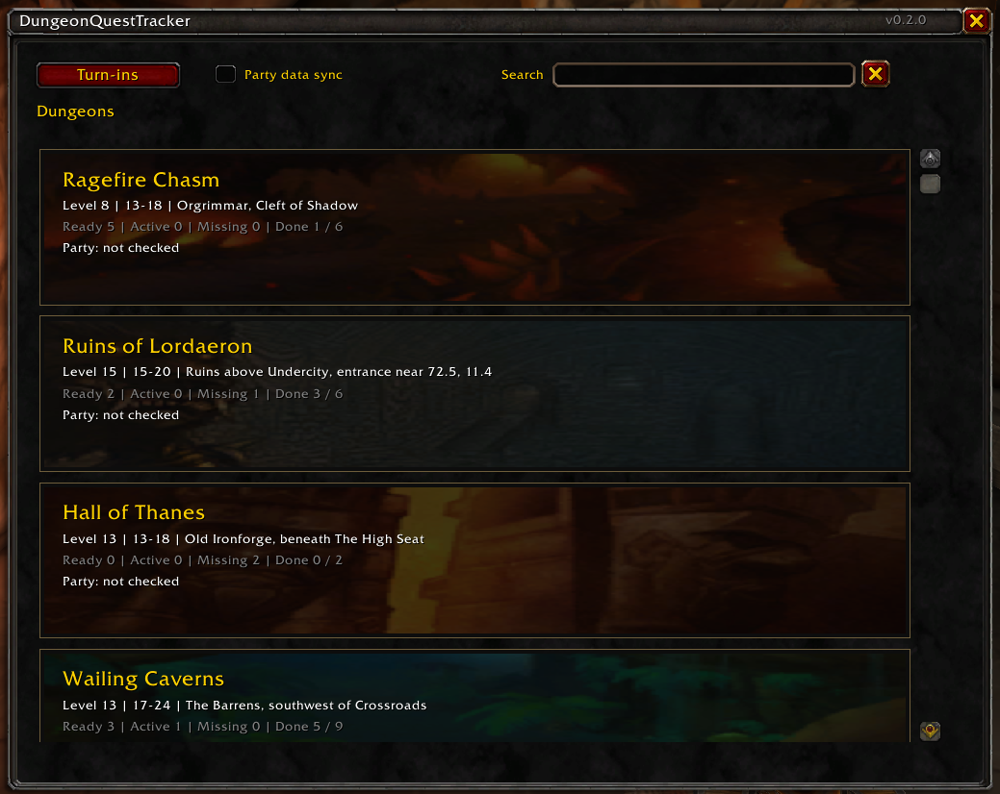
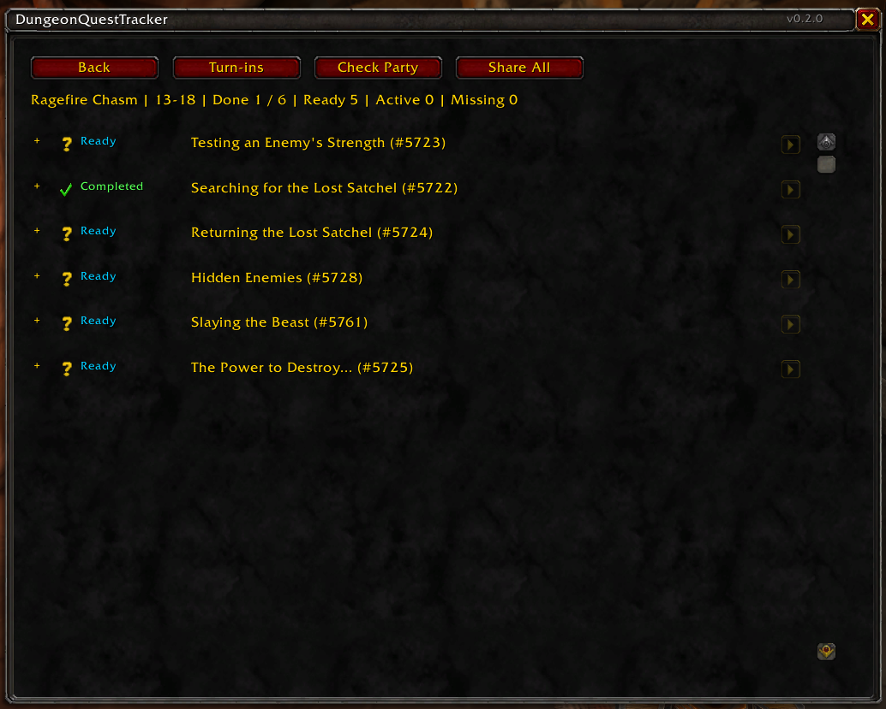
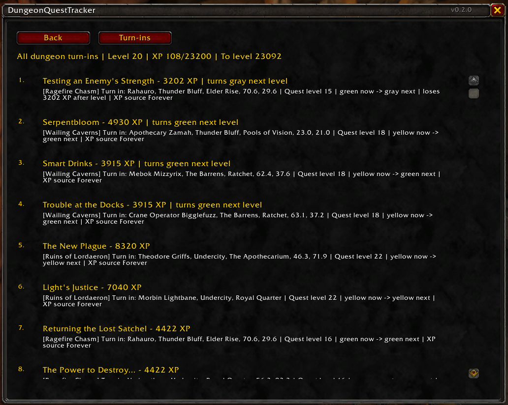
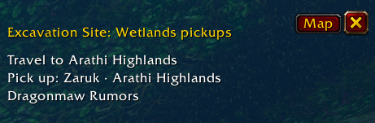
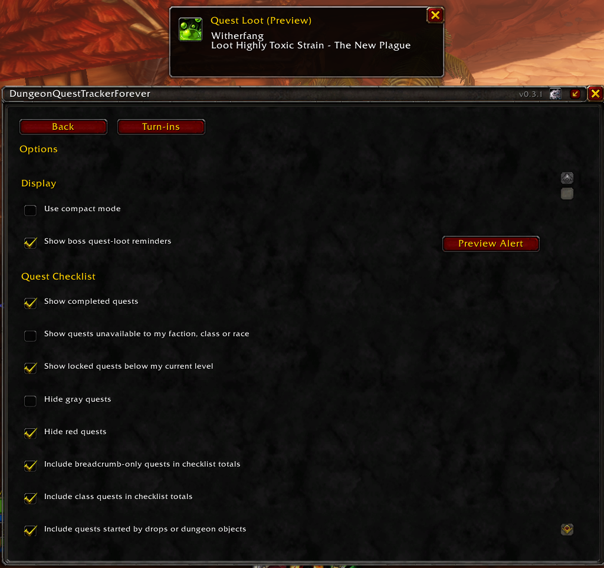

# DungeonQuestTrackerForever

A World of Warcraft: Forever addon for finding dungeon quests, following their chains, planning pickups and prioritizing turn-ins.

Available on [CurseForge](https://www.curseforge.com/wow/addons/dungeonquesttrackerforever).

## Features

- Find dungeons by name and track missing, locked, active, ready-to-turn-in, and completed quests.
- See where to pick up and turn in quests, what unlocks them, and which follow-ups belong to the same chain.
- Plan pickups across multiple dungeons with a movable route tracker, numbered map pins, and optional waypoints.
- Prioritize ready turn-ins by XP and level-up risk, with nearby turn-ins grouped when XP priority allows.
- Check party quest progress and share eligible quests individually or all at once.
- Get reminders for quest items dropped by named mobs.

## Screenshots

### Dungeon List



### Quest Checklist



### Turn-In Priority



### Pickup Route Tracker



### Quest Loot Alert



## Tracked Dungeons

Quest coverage spans 35 dungeon and wing entries through level 60.

- Ragefire Chasm
- Hall of Thanes
- Ruins of Lordaeron
- Wailing Caverns
- The Deadmines
- Shadowfang Keep
- The Stockade
- Blackfathom Deeps
- Excavation Site: Wetlands
- City of Dalaran
- Gnomeregan
- Razorfen Kraul
- Scarlet Monastery — Graveyard, Library, Armory and Cathedral
- Razorfen Downs
- Uldaman
- The Drowned City
- Krol'dok Stronghold
- Zul'Farrak
- Maraudon
- Alcaz Prison
- The Sunken Temple
- Blackrock Depths
- Dire Maul — East, North and West
- Lower Blackrock Spire
- Upper Blackrock Spire
- Blackmaw Hold
- Scholomance
- Stratholme — Main Gate and Service Gate
- Shaper's Terrace

Blackmaw Hold and Shaper's Terrace have initial coverage. Quest records identify provisional details, Classic XP fallbacks and unknown rewards where further review is needed.

## Installation

Download the addon ZIP from [CurseForge](https://www.curseforge.com/wow/addons/dungeonquesttrackerforever) or [GitHub releases](https://github.com/jturnham/DungeonQuestTracker/releases). Extract it into your Forever installation's Interface/AddOns directory, producing this layout.

```text
_forever_/Interface/AddOns/DungeonQuestTrackerForever/DungeonQuestTrackerForever.toc
```

Replace the existing addon folder when upgrading. Remove any older DungeonQuestTracker folder to avoid loading duplicate copies. Enable the addon in the character-selection AddOns list. Restart WoW after first installation or use /reload after updating.

## Getting Started

Open the addon with /dqt or the minimap button. Select a dungeon and expand quests for pickup locations, prerequisites and follow-ups. Use Turn-ins to plan hand-ins across your dungeon quests.

Click the spyglass on dungeon cards to combine their pickups into one route. The tracker updates as you accept quests or change zones. Drag it to reposition, hover to reveal its background, and click Map to focus the next stop. Hover map pins to see all quests at shared locations.

Travel settings support known flights, boats, zeppelins, trams and a ready Hearthstone with a recorded bind location. Optional TomTom or supported Blizzard waypoints guide you to the next mapped stop.

Party checks show responding members' quest progress. Share All sends eligible quests using the game's sharing rules.

Loot reminders cover known single-copy quest items from named mobs. Some reminders appear when you open the corpse's loot window. Click an alert to dismiss it or drag it to reposition.

## Settings And Commands

Open the title-bar gear button or /dqt options for level and quest filters, compact mode, text and window sizing, travel preferences, alerts, minimap controls and party settings. Tools provides settings profiles and position resets.

Active and ready quests keep their dungeon visible by default. Search can find dungeons outside the current visibility filters.

| Command | Action |
|---|---|
| /dqt | Open the addon |
| /dqt turnins | Open turn-in priority |
| /dqt options | Open settings |
| /dqt tools | Open profiles and utility controls |
| /dqt party | Show selected dungeon party readiness |
| /dqt filters | Explain hidden quests and dungeons |
| /dqt xp | View or export local XP observations |
| /dqt report <questID> | Preview a diagnostic report |

## Quest Data And Reports

XP and route predictions depend on the available quest data. Source labels distinguish published rewards, player reports, estimates and Classic fallbacks. Character level and bonuses can affect actual XP.

Enable local XP recording in Options, then use /dqt xp to copy observations for review. Review exports before posting them through [GitHub issues](https://github.com/jturnham/DungeonQuestTracker/issues). Reports are submitted manually and corrections require source review.

Party quest-data sync is optional and labels received records as unverified. Party status checks require responding members to have the addon.

See the [changelog](https://github.com/jturnham/DungeonQuestTracker/blob/main/CHANGELOG.md), [development instructions](https://github.com/jturnham/DungeonQuestTracker/blob/main/Tools/MAINTENANCE.md) and [XP review workflow](https://github.com/jturnham/DungeonQuestTracker/blob/main/Tools/XP-REVIEW.md) for project details.

## License

Addon code uses the [MIT License](https://github.com/jturnham/DungeonQuestTracker/blob/main/LICENSE). World of Warcraft names and related game content belong to Blizzard Entertainment.
